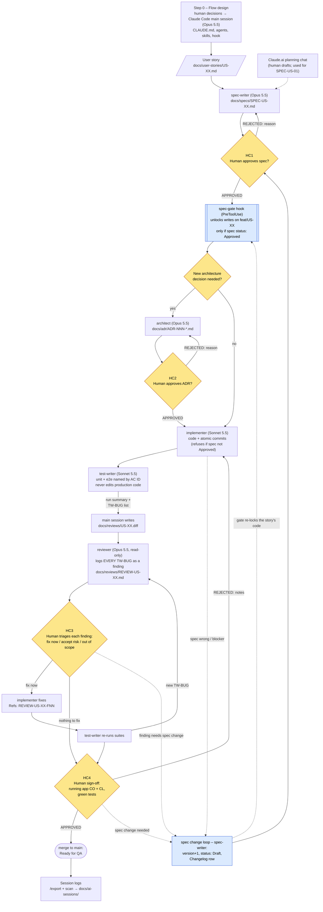

# FLOW.md – Agentic development flow

## 1. Overview

This repo turns a functional user story into a QA-ready increment through a spec-driven flow run in **Claude Code**. The main session orchestrates. Five subagents, each with its own tools and model, handle separate jobs: `spec-writer`, `architect`, `implementer`, `test-writer` and `reviewer`. Three versioned skills carry the project knowledge, and [CLAUDE.md](CLAUDE.md) holds the rules every agent follows. One human, **Andres Beltran**, approves or rejects at four checkpoints (HC1 spec, HC2 ADR, HC3 review triage, HC4 sign-off). A `PreToolUse` hook (the spec gate) blocks writes to app code until a story's spec is approved. Every step leaves a file in the repo, so you can follow a story from its text to the merge commit (see [§10](#10-traceability)). All three stories (US-01..03) went through this flow on 2026-11-23, and each ended with a `merge(US-NN): … ready for QA` commit on `main`.

- Global context: [CLAUDE.md](CLAUDE.md)
- Subagents: [.claude/agents/](.claude/agents/). Skills: [.claude/skills/](.claude/skills/). Hook: [.claude/hooks/spec-gate.mjs](.claude/hooks/spec-gate.mjs) (registered in [.claude/settings.json](.claude/settings.json))
- Phase prompts written by the human: [docs/prompts/](docs/prompts/). Session logs: [docs/ai-sessions/](docs/ai-sessions/)

**Models.** The main session and the `opus` subagents (spec-writer, architect, reviewer) ran on **Claude Opus 5.5** (`claude-opus-5-5`). The `sonnet` subagents (implementer, test-writer) ran on **Claude Sonnet 5.5** (`claude-sonnet-5-5`). The built-in `web-fetch` helper, used to read official docs, ran on **Claude Haiku 5.5** (`claude-haiku-5-5`). These IDs come from the `model` field of the session transcripts (38 subagent runs).

## 2. Diagram

**Order of work:** all specs (US-01..03) and the ADRs came first. Implementation followed, US-01 → US-02 → US-03. The multi-country decision affects every screen, so it was made once, up front. **Test-writer bug route:** the test-writer reports a bug as `TW-BUG-NN` and never fixes it. The reviewer must log every TW-BUG as a finding (source `test-writer`), so each one reaches the human at HC3. Example: TW-BUG-01 → [REVIEW-US-03-F01](docs/reviews/REVIEW-US-03.md).

## 3. Steps

| Step | Description | AI used? | AI, agent, subagent or skill used (tool · model · component) | Deliverable produced (repo path) | Human in the loop |
|------|-------------|----------|-------------------------------------------------------------|----------------------------------|-------------------|
| 0. Flow design | The human decides the flow, agents, checkpoints, gates and conventions, and writes them in the Phase 0 prompt. Claude Code drafts the context file, agents, skills, templates and spec-gate hook from those decisions, and checks Strapi/Angular facts against the official docs. | Yes | Claude Code · Claude Opus 5.5 · main session; `web-fetch` helper (Claude Haiku 5.5) for docs.strapi.io and angular.dev | [docs/prompts/phase-0-prompt.md](docs/prompts/phase-0-prompt.md), [CLAUDE.md](CLAUDE.md), [.claude/agents/](.claude/agents/), [.claude/skills/](.claude/skills/), [.claude/settings.json](.claude/settings.json), [.claude/hooks/spec-gate.mjs](.claude/hooks/spec-gate.mjs), [docs/adr/0000-template.md](docs/adr/0000-template.md), [docs/reviews/0000-template.md](docs/reviews/0000-template.md), [docs/user-stories/](docs/user-stories/) | Andres Beltran writes the decisions, reviews every generated file and answers `APPROVED` / `REJECTED: <reason>`. The first round was **REJECTED** with 6 changes, which Claude Code applied before approval. Nothing is committed before approval. |
| 0b. Planning chat (outside Claude Code) | The human's planning and prompt-writing workspace. It is also where SPEC-US-01 was drafted after two classifier blocks (see §8). | Yes | Claude.ai web chat · model as recorded in the exported chat log · no agents or tools | `docs/ai-sessions/2026-11-23-planning-chat-claude-ai.md` (added by the human at delivery); `docs/specs/SPEC-US-01.md` v1 draft | The human drafts and reviews. The output still goes through spec-writer review and HC1 like every spec. |
| 1. Spec | Turns the story into a verifiable spec: gaps with proposed resolutions, CO/CL matrix, Strapi data contract, Gherkin ACs with IDs and P1/P2 priority, test mapping, `version` and Changelog. | Yes | Claude Code · Claude Opus 5.5 · `spec-writer` subagent (Read/Grep/Glob/Write) + `spec-authoring` skill (+ `strapi5-content-modeling`) | `docs/specs/SPEC-US-XX.md` (`status: Draft`) | **HC1.** Andres Beltran checks that every AC is testable, gaps are resolved and country behavior is explicit. `APPROVED` → the main session sets `status: Approved`, `approved_by` and `approved_on`, and records it in the Changelog. `REJECTED: <reason>` → spec-writer re-runs with the reason. |
| 1b. Spec change (loop) | Any change to an approved spec bumps `version`, resets `status: Draft` and adds a Changelog row with the ACs affected. The spec gate then re-locks that story's code. | Yes | Claude Code · Claude Opus 5.5 · `spec-writer` + `spec-authoring` (versioning procedure) + spec-gate hook | Updated `docs/specs/SPEC-US-XX.md` (`version: N+1`) | **HC1 again**, with the same criteria. Code work resumes only after `APPROVED`. Used for all three specs (v2/v3) after the ADRs and the scaffold. |
| 2. Architecture decisions | Finds the decisions that need an ADR (at minimum the multi-country strategy) and writes them with real alternatives and consequences, verified against the official docs. Skipped when no new decision is needed. | Yes | Claude Code · Claude Opus 5.5 · `architect` subagent (Read/Grep/Glob/Write/WebFetch, no Edit/Bash) + Strapi/Angular skills | [docs/adr/ADR-001…005](docs/adr/) (`status: Proposed`) | **HC2.** The human checks for real alternatives, a justified choice and stated consequences. `APPROVED` → `status: Accepted`. `REJECTED: <reason>` → architect re-runs. |
| 2b. Scaffold | Infrastructure only: Strapi project, content types, bootstrap permissions, seed, Docker Compose, Angular shell. The hook blocks feature folders on this branch. | Yes | Claude Code · Claude Sonnet 5.5 · two `implementer` runs in parallel | `cms/`, `frontend/` shell, `docker-compose.yml` on `chore/scaffold-infra` (merge `465cf5f`) | Phase 2 checkpoint: the human checks `/co`, `/cl` and the Strapi admin by hand and decides on each finding (e.g. the `?status=draft` risk). |
| 3. Implementation | Implements the approved spec with atomic Conventional Commits (`feat(US-XX): …`, `Refs: SPEC-US-XX, ADR-NNN`). The implementer refuses if the spec is not `Approved`, and the spec-gate hook blocks writes under `frontend/`/`cms/` unless the branch and spec status allow them. | Yes | Claude Code · Claude Sonnet 5.5 · `implementer` subagent + `angular-conventions`, `strapi5-content-modeling`; spec-gate hook | Code in `frontend/`, `cms/`; commits on `feat/US-XX-<slug>` | No checkpoint here. The gate enforces HC1/HC2 upstream, and the human sees the results at HC3/HC4. |
| 4. Tests | Writes unit (Vitest) and e2e (Playwright) tests 1:1 with the ACs (names start with the AC ID), plus the public-write test (403/401). Runs them and reports bugs as `TW-BUG-NN` without touching production code. | Yes | Claude Code · Claude Sonnet 5.5 · `test-writer` subagent + `angular-conventions` | `frontend/src/**/*.spec.ts`, `frontend/e2e/*.spec.ts`, run summary with bug list | No checkpoint. Every TW-BUG becomes a review finding and reaches HC3. |
| 5. Review | The main session writes the commit list, changed files and diff to `docs/reviews/US-XX.diff`. The reviewer reads that file and reviews against the spec, ADRs, CLAUDE.md, security and a11y. It logs every TW-BUG as a finding. It is read-only and returns a report that the main session saves verbatim. | Yes | Claude Code · Claude Opus 5.5 · `reviewer` subagent (Read/Grep/Glob only) | `docs/reviews/US-XX.diff`, `docs/reviews/REVIEW-US-XX.md` | **HC3.** Andres Beltran decides per finding: `fix now` / `accept risk (reason)` / `out of scope`. The decision is recorded in the report's "Human decision" column. A finding that shows the spec is wrong goes to step 1b. |
| 6. Fixes | The implementer fixes the "fix now" findings (`fix(US-XX): …`, `Refs: REVIEW-US-XX-FNN`) and the test-writer re-runs the suites. Each finding records its resolution commit. Re-reviews read `US-XX-r2.diff`. | Yes | Claude Code · Claude Sonnet 5.5 · `implementer`, `test-writer`; Claude Opus 5.5 · `reviewer` for r2 | Fix commits; updated review table; [US-03-r2.diff](docs/reviews/US-03-r2.diff) | The human made the selection at HC3. A new TW-BUG goes back to HC3 (e.g. US-03 F10), and the result is checked at HC4. |
| 7. QA hand-off | The human runs the app (`docker compose up --build`) with green tests and checks the HC4 checklist by hand in CO and CL, including live Strapi edits. | No | n/a (the AI only prepares the checklist) | HC4 record in `REVIEW-US-XX.md`; `merge(US-XX): … ready for QA` commit | **HC4.** `APPROVED` → merge to `main`. `REJECTED: <notes>` → back to the implementer with the notes. |
| 8. Session logs | `/export` of each session, scanned for emails and secrets before committing. Raw JSONL transcripts are copied locally but **not committed** (see below). | Partly | Export: manual (`/export`). Scan and copy: Claude Code main session (Opus 5.5) | `docs/ai-sessions/2026-11-23-*.txt`, `docs/ai-sessions/README.md`; committed `raw/**/*.meta.json` only | The human runs `/export` and decides on every scan hit (the file is not committed and not edited). |
| 9. Final delivery | One-command start checked from a clean clone. The reviewer audits the repo against the brief, the human decides each gap (HC-final), docs are finalized, all suites are re-run, and the branch is merged and tagged. | Yes | Claude Code · Claude Opus 5.5 · main session + `reviewer` (audit mode, r2 re-review) | [docs/reviews/AUDIT-DELIVERY.md](docs/reviews/AUDIT-DELIVERY.md), this file, [README.md](README.md), tag `v1.0.0` | **HC-final**: a decision per audit gap, then the final `APPROVED` before merge and tag. |

**Raw transcripts: a decision that changed after ADR-005.** ADR-005 (Accepted in Phase 1, 2026-11-23) says the raw JSONL transcripts are committed. Later the same day, Andres Beltran decided they are **excluded**, because Claude Code injects the author's account email into every session and subagent context. The `/export` `.txt` files are the committed unedited logs, and `docs/ai-sessions/raw/**/*.jsonl` is gitignored. ADR-005 was left unchanged because Accepted ADRs are immutable (HC-final decision, 2026-11-23). This section and [docs/ai-sessions/README.md](docs/ai-sessions/README.md) record the change.

### Human checkpoints

| HC | What the human reviews | Approval criteria | On rejection |
|----|------------------------|-------------------|--------------|
| HC1 | Spec | Every AC is testable; gaps listed and resolved; country-specific behavior explicit | Back to spec-writer |
| HC2 | ADR | Real alternatives, justified choice, consequences stated | Back to architect |
| HC3 | Review report | Per finding: fix now / accept risk (with reason) / out of scope | Selected findings go to implementer |
| HC4 | Running app + green tests | ACs verified manually in both countries where relevant | Back to implementer with notes |

Silence, "looks good" or a question does not count as approval. Only an explicit `APPROVED` moves the flow forward.

### Status gates and the spec-gate hook

- Spec front matter has `status: Draft | Approved`, `version` and a Changelog. Any change after approval → `version + 1`, `status: Draft`, HC1 again.
- ADR `status: Proposed | Accepted | Superseded`.
- The implementer refuses a spec that isn't `Approved`. A **hook** enforces this, not only the instructions: `.claude/settings.json` runs [.claude/hooks/spec-gate.mjs](.claude/hooks/spec-gate.mjs) before every `Write`/`Edit`/`NotebookEdit`:

| Branch | Writes under `frontend/` or `cms/` |
|--------|------------------------------------|
| `feat/US-XX-<slug>` | allowed only if `docs/specs/SPEC-US-XX.md` has `status: Approved` |
| `chore/scaffold-<slug>` | allowed for infrastructure; blocked under `frontend/src/app/features/` |
| `main`, detached HEAD, anything else | blocked |

Verified on 2026-11-23 with 13 scripted cases and a live blocked write on `main`. Limitation: the hook does not gate `Bash` commands (generators, redirects). CLAUDE.md restricts them to the same branches, and the reviewer checks the commit range.

## 4. Tool choice: why Claude Code

| Need in this flow | Claude Code | Cursor / GitHub Copilot / Codex / OpenCode (at the time of the decision) |
|-------------------|-------------|--------------------------------------------------------------------------|
| Subagents with separate responsibilities and **per-agent tool allow-lists and models** | Markdown definitions in `.claude/agents/` with `tools:` and `model:` front matter, versioned in the repo. The reviewer physically has no Edit/Bash, and the test-writer is told not to touch production code. | Mostly a single agent with mode-level settings. Custom agents exist in some tools, but per-agent tool restriction is less granular or not versioned the same way. |
| A **hard gate** instead of a polite request | `PreToolUse` hooks can deny a tool call, so the spec gate is enforced by the tool | Rules files or instructions only. No equivalent pre-write deny hook for file edits in the versions considered. |
| Reusable project knowledge | Skills (`.claude/skills/*/SKILL.md`) loaded on demand and corrected as facts were verified | Rules / instructions files, always loaded and with no on-demand packaging |
| One context file for every agent | `CLAUDE.md` | `AGENTS.md`, `.cursorrules`, `copilot-instructions.md` (equivalent) |
| **Unedited session logs** as a deliverable | `/export` of the full session including subagent hand-offs, plus raw JSONL per subagent | Chat history export is partial or manual |
| Setup cost on a one-day deadline | Already installed and in use (VS Code extension) | Learning cost plus adapting the process |

Trade-offs accepted: vendor lock-in (agent and hook formats) and dependence on one provider's safety classifier, which did block one step (see §8). Details: [ADR-005](docs/adr/ADR-005-development-flow-and-tooling.md).

## 5. SDD choice: own lightweight variant

We use our own spec-driven variant rather than GitHub Spec Kit or Kiro ([ADR-005](docs/adr/ADR-005-development-flow-and-tooling.md), options 1–4). Spec Kit (constitution → specify → plan → tasks → implement) and Kiro (requirements → design → tasks) come with a fixed artifact pipeline. Neither has a native step for an ADR with alternatives, a review-finding triage step, or a hard spec gate, and we would have spent the day bending them to fit. Our variant keeps what this assessment grades: one spec per story with gap analysis, a CO/CL matrix and Gherkin ACs with IDs; a versioned spec change loop; ADRs for decisions; four named human checkpoints; and a hook that enforces "no code before an approved spec". The cost: the process is custom, mostly enforced by prose, and has no community templates.

## 6. Evidence of human control

Each item links to the artifact or log line where the decision is recorded.

- **Phase 0 rejected with 6 changes** (hook-enforced gate, spec versioning loop, test-writer bugs as findings, automated Strapi permissions + 403 test, raw logs, reviewer diff file): [phase-0 log, line 890](docs/ai-sessions/2026-11-23-phase-0.txt).
- **HC1 rejections:** SPEC-US-02 v1 rejected (add P1/P2 tags) and SPEC-US-03 v1 rejected (Scenario Outlines with CO/CL examples, fictitious RUT examples): see the Changelog tables in [SPEC-US-02](docs/specs/SPEC-US-02.md#changelog) and [SPEC-US-03](docs/specs/SPEC-US-03.md#changelog), and [phase-1 log, lines 405 and 712](docs/ai-sessions/2026-11-23-phase-1.txt).
- **P1/P2 scope decision** for a same-day deadline (P1 = story ACs plus validation, country filtering, 403 and double submit, always automated; P2 = tested if time allows, otherwise checked by hand and listed in the README). The human also promoted single ACs: US-02-AC-05 and US-03-AC-06/07 to P1: [phase-1 log, lines 405–420 and 712–725](docs/ai-sessions/2026-11-23-phase-1.txt).
- **SPEC-US-01 open questions answered by the human** (OQ-1 keep state per country, OQ-2 misconfigured fields, OQ-3 document types, OQ-5 loading-state AC): [SPEC-US-01 GAP-15/16/23/25 and Changelog v1](docs/specs/SPEC-US-01.md).
- **HC2:** ADR-001..004 approved one by one, plus ADR-005: [phase-1 log, line 1905](docs/ai-sessions/2026-11-23-phase-1.txt).
- **Overrides of the agent's proposals at HC3:** the reviewer proposed accepting a11y nits, and the human chose to fix them instead: [REVIEW-US-01-F04](docs/reviews/REVIEW-US-01.md), [REVIEW-US-02-F02](docs/reviews/REVIEW-US-02.md), [REVIEW-US-03-F09](docs/reviews/REVIEW-US-03.md). The human also required the code to follow Accepted ADR-004 instead of the implementer's deliberate deviation ([REVIEW-US-03-F03](docs/reviews/REVIEW-US-03.md)).
- **`?status=draft` risk decision:** accepted as a known risk with a proposed fix: [phase-2 log, line 756](docs/ai-sessions/2026-11-23-phase-2.txt), and [README "Known risks"](README.md#known-risks).
- **Clean reset decision** (wipe the Strapi volume to prove the seed from a clean state before US-03 HC4): [US-03 log, line 1841](docs/ai-sessions/2026-11-23-US-03.txt).
- **Manual HC4 checks, including live Strapi changes** (field order changed in the admin and reflected after reload, recommended plan moved, CMS stopped to test retry, keyboard-only flow in Chile): [US-01 log, line 1496](docs/ai-sessions/2026-11-23-US-01.txt), [US-02 log, line 1157](docs/ai-sessions/2026-11-23-US-02.txt), [US-03 log, line 2147](docs/ai-sessions/2026-11-23-US-03.txt).
- **HC-final:** a decision for each audit gap (e.g. keep ADR-005 unchanged, keep the phase-0 log, list the new r2 finding instead of fixing it): [AUDIT-DELIVERY.md, "Gaps summary"](docs/reviews/AUDIT-DELIVERY.md#gaps-summary).
- **Agent stops instead of working around:** the permission classifier blocked `docker compose down -v` in the final phase because it would delete the human's data volume. The main session verified the clean state with a fresh clone and separate volumes instead, and reported it.

## 7. What would change with a team of 5 developers

- **One branch and PR per story.** The reviewer's report is posted as PR review comments, and HC3 decisions are made as replies on the PR instead of in a chat.
- **CI as the gate.** Unit, e2e, the Strapi permissions test (public write → 403) and a server-side spec-gate check (does the PR's story spec have `status: Approved`?) become required checks. The local hook stays as fast feedback. CI also closes the `Bash` gap, because it checks the result rather than the tool calls.
- **CODEOWNERS** for `docs/specs/`, `docs/adr/`, `CLAUDE.md` and `.claude/`. A spec or ADR status change needs an owner's approval, not just whoever runs the session.
- **Rotating human approvers** per checkpoint (e.g. product owner at HC1, tech lead at HC2/HC3, QA at HC4) instead of one approver as the bottleneck.
- **Parallel stories with explicit dependencies.** Each spec declares the ADRs it depends on (already in `adrs:` front matter). A story starts only when those ADRs are Accepted. Shared ADRs (multi-country, permissions) are decided first, as here.
- **A shared skills library** (versioned, reviewed like code), so a fact one developer verifies, such as `inject()` before `await`, reaches everyone's agents.
- **Cost and model policy per agent:** keep Opus for spec, architecture and review, Sonnet for implementation and tests, Haiku for doc fetching, with a token budget per story tracked in CI.
- **Logs:** session logs per developer in one location, with an automated email and secret scan as a pre-commit hook.

## 8. What did not work as expected and how we adjusted it

- **A safety classifier blocked SPEC-US-01 (Phase 1).** Two `spec-writer` runs for US-01 were stopped mid-write and produced no file. The second run already used stricter content rules (validators described by behavior only, clearly fake examples). The likely trigger is the national-ID validator content (Chilean RUT check digit, Colombian ID). The main session did not retry a third time or work around the block, and escalated to the human. **Adjustment:** Andres Beltran drafted SPEC-US-01 with AI in his Claude.ai planning chat (step 0b) and reviewed it. `spec-writer` then reviewed and completed it (gaps, P1/P2, format, consistency with SPEC-US-02/03), and it went through HC1 as usual.
- **The seed did not match the spec (Phase 2).** The first plan seed did not match the SPEC-US-02 §3 seed table (names, prices). The main session caught this while verifying the stack from a clean state and sent it back to the implementer before the checkpoint. **Adjustment:** seed tables in specs are treated as contracts and checked against the API at every checkpoint.
- **Skills were partly wrong at first.** The `strapi5-content-modeling` and `angular-conventions` skills contained unverified or wrong statements: the permission model, 403 vs 405, strict query params, `rxResource` for timeouts, `inject()` before `await`. Implementers reported them, and the facts were checked against the official docs. **Adjustment:** the skills were corrected, so later stories started from verified facts, and unverified statements are marked `[unverified]`.
- **A skill rule did not prevent the bug it describes (US-03).** The skill said "in async functional guards, call every `inject()` before the first `await`". The US-03 implementer still wrote `summaryGuard` with `inject()` after `await`. The code compiled and the 95 existing unit tests passed, but at runtime every valid user hit NG0203. The test-writer caught it (TW-BUG-01 → [REVIEW-US-03-F01](docs/reviews/REVIEW-US-03.md), blocker). **Lesson:** guidance read at writing time is not enough for a bug that only shows at runtime. **Adjustment:** a blocker-level item in the reviewer checklist ([.claude/agents/reviewer.md](.claude/agents/reviewer.md) step 2.7) and an async-guard unit-test pattern in the `angular-conventions` skill §8 (commit `8dbbe7e`). The r2 re-review confirmed both were applied.
- **A fix caused a regression (US-03).** The fix for F02 (block payment when terms are unchecked) moved focus to the disabled "Pagar" button, so keyboard users lost their place. The test-writer's re-run caught it as TW-BUG-02, and it went through HC3 as [REVIEW-US-03-F10](docs/reviews/REVIEW-US-03.md) (fixed in `dc2e46e`). The r2 re-review then found one more edge case in the F03 fix (F11, listed in README).
- **Docker Compose bake on Windows.** `docker compose up --build` failed with "failed to execute bake". The human deferred it at US-01 HC4. In the final phase the root cause was isolated: Buildx bake's entitlement check fails when the shell's working directory has a lowercase drive letter (`c:\`, the VS Code default). `COMPOSE_BAKE=false` does not help. Running from an uppercase drive or setting `BUILDX_BAKE_ENTITLEMENTS_FS=0` both fix it, and both are documented in the README. CRLF checkouts also broke the cms entrypoint (fixed with `.gitattributes` `*.sh eol=lf` and a `sed` in the Dockerfile).
- **A stray dev server on `localhost:4200`.** A leftover local dev server answered on `localhost:4200`, the same port as the Docker app, so a manual check could hit the wrong app. **Adjustment:** checks and e2e runs use `127.0.0.1:4200` (`E2E_BASE_URL`).
- **The hook does not gate `Bash`.** Generators and shell redirects can write under `frontend/`/`cms/` without passing the spec gate. **Adjustment:** a CLAUDE.md rule (generators only on allowed branches) and a reviewer process check of the commit range. With a team, CI would close this gap (§7).
- **The author's email in raw transcripts.** Claude Code injects the account email into every session and subagent context, so the raw JSONL cannot be committed unedited. **Adjustment (standing decision, Andres Beltran):** raw JSONL is gitignored and the `/export` files are the committed logs. One local part in a scan command inside the phase-0 export was kept by explicit decision ([docs/ai-sessions/README.md](docs/ai-sessions/README.md)).

## 9. Where AI was deliberately not used, and why

- **All approval and rejection decisions (HC1–HC4, HC-final).** The point of the checkpoints is an accountable human judgment. An agent approving its own (or another agent's) work would defeat them. The main session only summarizes and waits for an explicit `APPROVED`.
- **The P1/P2 scope decision.** Deciding what to cut on a same-day deadline is a business trade-off, not a technical one.
- **Manual browser checks at HC4** in CO and CL: keyboard-only flow, 320/360 px layouts, live Strapi edits, CMS outage and retry. They confirm the tests check the right things, and they are the human's own evidence for sign-off.
- **Creating the Strapi admin user.** Credentials must never pass through an agent or end up in a log or the repo.
- **Repository and GitHub setup** (repo creation, visibility, access for the evaluator), because they are account-level actions with external effect.
- **Not committing the raw transcripts.** A privacy decision about the author's own data.
- **Running `/export`.** It is a client command, and doing it by hand keeps the logs unedited.

**Honest note:** SPEC-US-01 was **not** written by hand. After the two classifier blocks, the human drafted it **with AI** in the Claude.ai planning chat, reviewed it, and then ran it through `spec-writer` and HC1. Its authorship trail is split across two tools (Changelog v1 in [SPEC-US-01](docs/specs/SPEC-US-01.md#changelog)).

## 10. Traceability

The chain for every story: `US-XX` → `SPEC-US-XX` vN (ACs `US-XX-AC-NN`, Changelog) → `ADR-NNN` → commits (`feat(US-XX)`, `Refs: SPEC-US-XX, ADR-NNN`) → tests named `US-XX-AC-NN …` → `US-XX.diff` → `REVIEW-US-XX-FNN` with resolution commit → merge. Conventions: [CLAUDE.md](CLAUDE.md#traceability-conventions). ACs with no automated test are P2 items checked by hand (README "Manual checks").

**Shared:** ADR-001 (multi-country content model), ADR-002 (country resolution in the frontend), ADR-003 (Strapi public permissions in bootstrap), ADR-004 (wizard state in the browser), ADR-005 (flow and tooling). Scaffold: `chore/scaffold-infra` → merge `465cf5f`. The public-write denial is also tested in [cms/tests/public-permissions.test.mjs](cms/tests/public-permissions.test.mjs).

### US-01 – Policyholder and vehicle data form

| Link | Artifact |
|------|----------|
| Story | [docs/user-stories/US-01.md](docs/user-stories/US-01.md) |
| Spec | [SPEC-US-01](docs/specs/SPEC-US-01.md) **v2**, Approved (25 ACs) |
| ADRs | ADR-001, ADR-002, ADR-003, ADR-004 |
| Main commits | `04566ac` feat: form-field mapper, validation engine and clock · `58e2767` feat: render step 1 form from Strapi config |
| Tests | Unit: `core/country-retry.spec.ts`, `applicant-form/applicant-form.spec.ts`, `applicant-form-fixround.spec.ts`, `form-field-config.spec.ts`, `validators.spec.ts`, `validators-rut.spec.ts`. e2e: `e2e/us-01-data-form.spec.ts`, `e2e/full-flow-keyboard.spec.ts`. ACs with tests: AC-01..20, AC-22..25. AC-21 (320 px) checked by hand at HC4 |
| Review | [docs/reviews/US-01.diff](docs/reviews/US-01.diff) → [REVIEW-US-01](docs/reviews/REVIEW-US-01.md) |
| Merge | `0027b69` merge(US-01): … ready for QA |

### US-02 – Plan list

| Link | Artifact |
|------|----------|
| Story | [docs/user-stories/US-02.md](docs/user-stories/US-02.md) |
| Spec | [SPEC-US-02](docs/specs/SPEC-US-02.md) **v3**, Approved (21 ACs) |
| ADRs | ADR-001, ADR-002, ADR-003, ADR-004 |
| Main commits | `e4a233f` feat: pricing function, plan model and plans API · `43e7955` feat: guard plans step on valid step 1 data · `a4c7483` feat: plan list step with selection and states |
| Tests | Unit: `plan-list/plan-list.spec.ts`, `plan-list-fixes.spec.ts`. e2e: `e2e/us-02-plan-list.spec.ts`. ACs with tests: AC-01..05, 09, 10, 12, 14..19. AC-06, 07, 08, 11, 13, 20, 21 are P2, checked by hand (README) |
| Review | [docs/reviews/US-02.diff](docs/reviews/US-02.diff) → [REVIEW-US-02](docs/reviews/REVIEW-US-02.md) |
| Merge | `ec0e59a` merge(US-02): … ready for QA |

### US-03 – Summary and payment

| Link | Artifact |
|------|----------|
| Story | [docs/user-stories/US-03.md](docs/user-stories/US-03.md) |
| Spec | [SPEC-US-03](docs/specs/SPEC-US-03.md) **v3**, Approved (22 ACs) |
| ADRs | ADR-001, ADR-002, ADR-003, ADR-004 |
| Main commits | `a6f74b1` feat: summary helpers (mask, quote number, row model) · `1010f80` feat: summary and confirmation steps with simulated payment · fixes `0e598a7`, `7282b88`, `d450e35`, `59fd7d0`/`ebfc6df`, `0fcb455`, `dc2e46e` |
| Tests | Unit: `summary/summary.spec.ts`, `summary/summary-guard.spec.ts`. e2e: `e2e/us-03-summary-payment.spec.ts`, `e2e/full-flow-keyboard.spec.ts`. ACs with tests: AC-01..12, 14, 20, 22. AC-13, 15..19, 21 are P2, checked by hand (README) |
| Review | [docs/reviews/US-03.diff](docs/reviews/US-03.diff) → [REVIEW-US-03](docs/reviews/REVIEW-US-03.md) (F01–F10); re-review [US-03-r2.diff](docs/reviews/US-03-r2.diff) → r2 section (F11) |
| Merge | `4f969ef` merge(US-03): … ready for QA |
