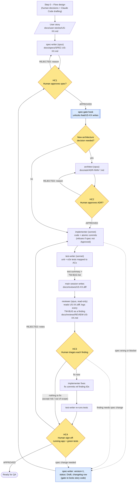

# FLOW.md – Agentic development flow

> Skeleton. Steps are filled in as they are defined and used; TODO sections are completed at the end of the project.

How a functional user story becomes a QA-ready increment in this repo: a spec-driven flow run in **Claude Code**, with five subagents, three custom skills, a global context file and four human checkpoints.

- Global context: [CLAUDE.md](CLAUDE.md)
- Subagents: [.claude/agents/](.claude/agents/) (`spec-writer`, `architect`, `implementer`, `test-writer`, `reviewer`)
- Skills: [.claude/skills/](.claude/skills/) (`spec-authoring`, `strapi5-content-modeling`, `angular-conventions`)
- Session logs: [docs/ai-sessions/](docs/ai-sessions/)

## Diagram

**Order of work:** all specs (US-01..03) and the ADRs come first, then implementation US-01 → US-02 → US-03. The multi-country decision affects every screen, so it is taken once, up front.

## Steps

| Step | Description | AI used? | AI, agent, subagent or skill used | Deliverable produced | Human in the loop |
|------|-------------|----------|-----------------------------------|----------------------|-------------------|
| 0. Flow design | The human decides the flow, agents, checkpoints, gates and conventions (written in `docs/prompts/phase-0-prompt.md`). Claude Code drafts the context file, agents, skills, templates and the spec-gate hook from those decisions, and verifies Strapi/Angular facts against official docs. | Yes | Claude Code (Opus 5.5), main session; web-fetch helper for docs.strapi.io and angular.dev | `docs/prompts/phase-0-prompt.md`, `CLAUDE.md`, `.claude/agents/*`, `.claude/skills/*`, `.claude/settings.json`, `.claude/hooks/spec-gate.mjs`, `docs/adr/0000-template.md`, `docs/reviews/0000-template.md`, `docs/user-stories/*`, `FLOW.md`, `README.md` | Andres Beltran writes the decisions, reviews all generated files, and answers `APPROVED` / `REJECTED: <reason>`. The first round was **REJECTED** with 6 changes (hook-enforced gate, spec versioning loop, test-writer bugs as findings, automated Strapi permissions + 403 test, raw transcript logs, reviewer diff file); Claude Code applied them. Commit only after approval. |
| 1. Spec | Turns the story into a verifiable spec: gaps with proposed resolutions, CO/CL matrix, Strapi data contract, Gherkin ACs with IDs, test mapping, `version` + Changelog. | Yes | Claude Code → `spec-writer` subagent (opus) + `spec-authoring` skill (+ `strapi5-content-modeling`) | `docs/specs/SPEC-US-XX.md` (`status: Draft`, `version: 1`) | **HC1.** Andres Beltran checks that every AC is testable, gaps are resolved, and country behavior is explicit. `APPROVED` → main session sets `status: Approved`, `approved_by`, `approved_on` and records the approval in the Changelog. `REJECTED: <reason>` → spec-writer re-runs with the reason. |
| 1b. Spec change (loop) | Any change to an approved spec (raised by the human, an implementer blocker, a test-writer bug or a review finding) bumps `version`, resets `status: Draft`, and adds a Changelog row with the ACs affected. The spec gate then re-locks that story's code. | Yes | `spec-writer` (opus) + `spec-authoring` (versioning procedure) + `spec-gate` hook | Updated `docs/specs/SPEC-US-XX.md` (`version: N+1`) | **HC1 again**, same criteria. Code work on the story resumes only after `APPROVED`. |
| 2. Architecture decisions | Identifies decisions that need an ADR (at minimum the multi-country strategy) and writes them with ≥ 3 real alternatives and consequences; verifies framework facts on official docs. Skipped when no new decision is needed. | Yes | Claude Code → `architect` subagent (opus) + Strapi/Angular skills + WebFetch | `docs/adr/ADR-NNN-*.md` (`status: Proposed`) | **HC2.** The human checks for real alternatives, a justified choice and stated consequences. `APPROVED` → `status: Accepted`. `REJECTED: <reason>` → architect re-runs. |
| 3. Implementation | Implements the approved spec in Angular/Strapi with atomic Conventional Commits (`feat(US-XX): …`, `Refs: SPEC-US-XX, ADR-NNN`). Refuses if the spec isn't `Approved`, and the `spec-gate` hook blocks file writes under `frontend/`/`cms/` unless the branch and spec status allow them. Infrastructure goes on `chore/scaffold-*`. | Yes | Claude Code → `implementer` subagent (sonnet) + `angular-conventions`, `strapi5-content-modeling`; `.claude/hooks/spec-gate.mjs` | Code in `frontend/`, `cms/`; commits on `feat/US-XX-<slug>` | No checkpoint: the gate enforces HC1/HC2 upstream, and the human sees results at HC3/HC4. |
| 4. Tests | Writes unit and e2e tests 1:1 with the ACs (names start with the AC ID), plus the public-write-returns-403 test when Strapi is touched. Runs them and reports bugs as `TW-BUG-NN` without touching production code. | Yes | Claude Code → `test-writer` subagent (sonnet) + `angular-conventions` | `frontend/src/**/*.spec.ts`, `frontend/e2e/**`, test run summary with bug list | No checkpoint; every `TW-BUG` becomes a review finding and reaches HC3. |
| 5. Review | The main session writes the commit list, changed files and diff to `docs/reviews/US-XX.diff`. The reviewer reads it, reviews against the spec, ADRs, CLAUDE.md, security and a11y, and logs every test-writer bug as a finding. Read-only; returns a report that the main session saves. | Yes | Claude Code main session (diff file) → `reviewer` subagent (opus, Read/Grep/Glob only) | `docs/reviews/US-XX.diff`, `docs/reviews/REVIEW-US-XX.md` | **HC3.** Andres Beltran decides per finding: `fix now` / `accept risk (reason)` / `out of scope`, recorded in the report. A finding that shows the spec is wrong goes to the spec change loop (1b). |
| 6. Fixes | Implementer fixes the "fix now" findings (`fix(US-XX): …`, `Refs: REVIEW-US-XX-FNN`); test-writer re-runs the suites; the resolution commit is recorded per finding. | Yes | `implementer` (sonnet), `test-writer` (sonnet) | Fix commits; updated review table | The human reviewed the selection at HC3; the result is checked at HC4. |
| 7. QA hand-off | The human runs the app (`docker compose up`) and checks ACs manually in CO and CL where relevant, with green tests. | No | n/a | DoD checklist in CLAUDE.md ticked; sign-off noted | **HC4.** `APPROVED` → ready for QA (merge). `REJECTED: <notes>` → back to implementer with notes. |
| 8. Session logs | Export the session (`/export`) and copy the raw JSONL transcripts (main + subagents) from `~/.claude/projects/…` without editing; scan for secrets or personal data before committing. | No (manual copy) | n/a | `docs/ai-sessions/*.txt`, `docs/ai-sessions/raw/**` | The human resolves any scan hit (the file is not committed and not edited). |

## Human checkpoints

| HC | What the human reviews | Approval criteria | On rejection |
|----|------------------------|-------------------|--------------|
| HC1 | Spec | Every AC is testable; gaps listed and resolved; country-specific behavior explicit | Back to spec-writer |
| HC2 | ADR | Real alternatives, justified choice, consequences stated | Back to architect |
| HC3 | Review report | Per finding: fix now / accept risk (with reason) / out of scope | Selected findings go to implementer |
| HC4 | Running app + green tests | ACs verified manually in both countries where relevant | Back to implementer with notes |

Human approver: **Andres Beltran**.

## Status gates and the spec gate hook

- Spec front matter `status: Draft | Approved` plus `version` and a Changelog. Any change after approval → `version + 1`, `status: Draft`, HC1 again.
- ADR `status: Proposed | Accepted | Superseded`.
- The implementer refuses a spec that isn't `Approved`, and this is **enforced by a hook**, not only by instructions. `.claude/settings.json` runs [.claude/hooks/spec-gate.mjs](.claude/hooks/spec-gate.mjs) before every `Write`/`Edit`/`NotebookEdit`:

| Branch | Writes under `frontend/` or `cms/` |
|--------|------------------------------------|
| `feat/US-XX-<slug>` | allowed only if `docs/specs/SPEC-US-XX.md` has `status: Approved` |
| `chore/scaffold-<slug>` | allowed for infrastructure; blocked under `frontend/src/app/features/` |
| `main`, detached HEAD, anything else | blocked |

Verified on 2026-11-23: 13 scripted cases plus a live blocked write on `main`. Limitation: `Bash` commands (generators, redirects) aren't gated by the hook. CLAUDE.md restricts them to the same branches, and the reviewer checks it.

## Traceability

`US-XX` → `SPEC-US-XX` vN (ACs `US-XX-AC-NN`, Changelog) → `ADR-NNN` → commits (`feat(US-XX)`, `Refs: SPEC-US-XX, ADR-NNN`) → tests named `US-XX-AC-NN …` → `US-XX.diff` → `REVIEW-US-XX-FNN` (including `TW-BUG`s) with resolution commit. Conventions: [CLAUDE.md](CLAUDE.md#traceability-conventions).

## Tool choice justification

TODO

## SDD variant justification

TODO

## What we would do differently with a team of 5 developers

TODO

## What did not work as expected and how we adjusted it

- **SPEC-US-01 blocked by a safety classifier (2026-11-23, Phase 1).** Two separate `spec-writer` runs for US-01 were stopped mid-write by a safety classifier, and no file was produced. The second run had stricter content rules: validators described by behavior only, clearly fake examples only. The likely trigger is the national-ID validator content (Chilean RUT check digit, Colombian ID format), even with fictitious data. The main session did not retry a third time or try to work around the block, and escalated to the human. **Adjustment:** Andres Beltran drafted SPEC-US-01 outside Claude Code, in his planning chat on Claude.ai (its log is in `docs/ai-sessions/`), and reviewed the draft himself. Inside Claude Code, `spec-writer` then only reviews and completes it: remaining gaps, P1/P2 tags, format against the `spec-authoring` skill, and consistency with SPEC-US-02/03 (`vehicleYear` field identification, 10 s timeout, `maskInSummary`). It then goes through HC1 as usual.

- **Phase 2 scaffold split across two implementers (2026-11-23).** `cms/`+Docker and the Angular shell were built by two `implementer` runs in parallel on `chore/scaffold-infra`, each committing only its own paths. The main session then verified the whole stack from a clean state itself. **Finding 1:** the first plan seed did not match the SPEC-US-02 §3 seed table (names, prices); the main session caught it while verifying and sent it back to the implementer before the checkpoint. **Adjustment:** seed tables in specs are treated as contracts and checked against the API at every checkpoint.
- **Finding 2 (security): drafts are readable with `?status=draft` (2026-11-23, Phase 2).** Strapi 5.63 honors `status=draft` for anonymous `find`, so the Public role can read unpublished entries. Draft & Publish hides drafts from the app's queries, not from a direct caller. ADR-003 did not anticipate this. **Human decision (Andres Beltran):** accepted as a known risk for now (low impact: unpublished business content, no personal data), recorded in README "Known risks". **Proposed fix, if time remains:** a global Strapi middleware that forces `status=published` on unauthenticated `/api` requests, plus a test.
- **Skills corrected from verified facts (Phase 2).** Implementers reported where the `strapi5-content-modeling` and `angular-conventions` skills were unverified or wrong (permission model, 403 vs 405, strict params, `rxResource` for timeouts, `inject()` before `await` in guards). The main session updated the skills so later stories start from verified facts.
- **Windows host issues (Phase 2).** Docker Compose 5.6 bake failed on drive-letter case (`BUILDX_BAKE_ENTITLEMENTS_FS=0` workaround, in README troubleshooting), and CRLF checkouts broke the cms entrypoint (`.gitattributes` with `*.sh eol=lf`).

TODO (remaining items at project end)

## Where AI was deliberately not used, and why

TODO
